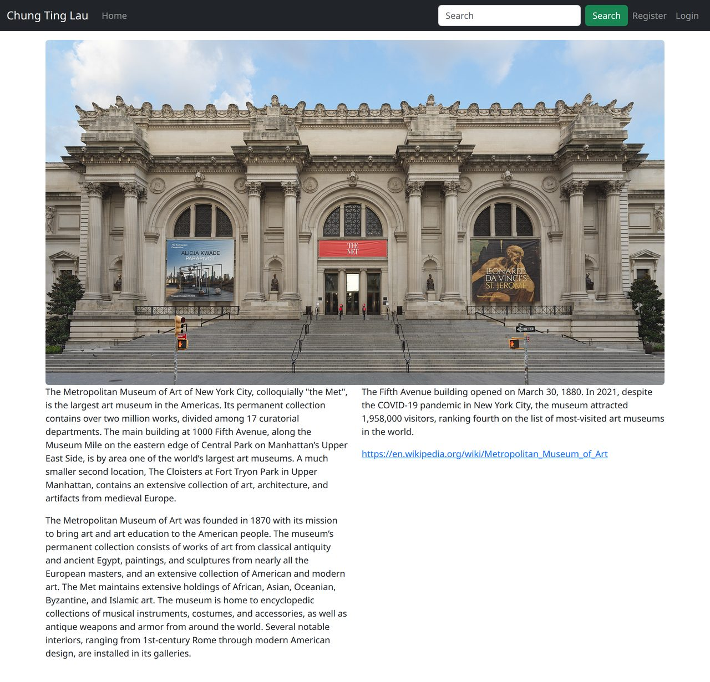
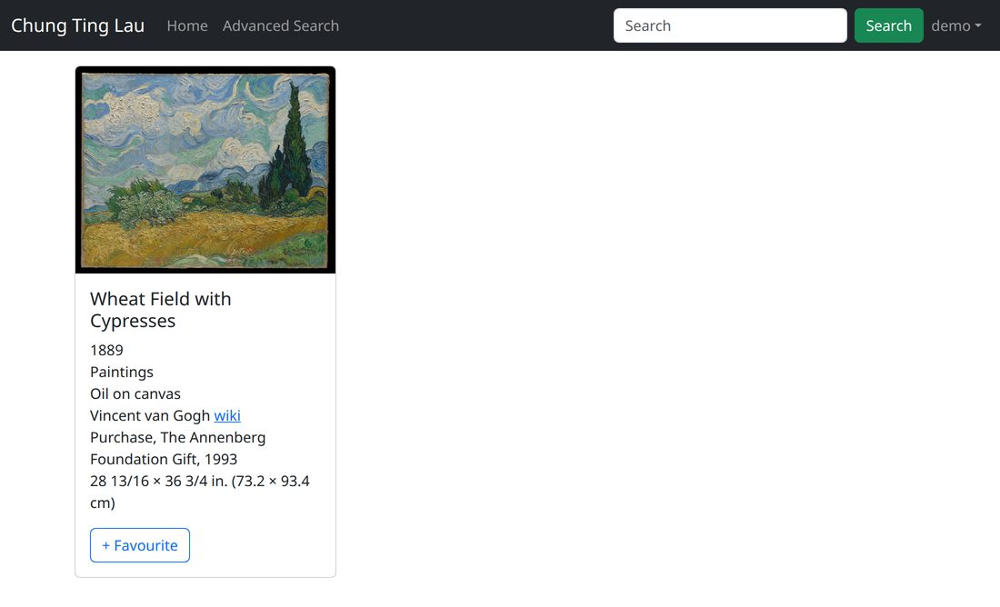

# Metropolitan Museum

A Next.js app for browsing the Metropolitan Museum of Art: search the collection, open an artwork, and save favourites to your account.

**Live demo:** [https://my-app-pjm7.vercel.app/](https://my-app-pjm7.vercel.app/)

## Screenshots

Home introduces the museum. Register and Login are in the navbar until you sign in.



An artwork page loads the Met’s object record and can add that work to your favourites. This one is Vincent van Gogh’s *Wheat Field with Cypresses*.



## Features

Home, login, and register are public. Every other page redirects to `/login` when no token is stored.

- **Home** — a photograph of the Fifth Avenue building and a short introduction, with a link to the Wikipedia article.
- **Quick search** — the navbar searches by title (`title=true&q=…`), stores the query, and opens the results page.
- **Advanced search** (signed in) — a required query, plus search by title, tags, or artist/culture. Optional geo location and medium (case-sensitive, with examples in the form). Checkboxes for highlighted works and works currently on view. The form uses react-hook-form and asks for a query before it submits.
- **Results** — a grid of cards (image, title, date, classification, medium) linking to the artwork page. Returned IDs are limited to the bundled list in `public/data/validObjectIDList.json`, then split into pages of 12 with previous/next controls. An empty result shows “Nothing Here”. Cards without an image use a placeholder.
- **Artwork detail** — the Met object record: image (when the museum provides one), title, date, classification, medium, artist with a Wikidata link, credit line, dimensions, and a **+ Favourite** toggle.
- **Favourites** — the signed-in user’s saved object IDs, rendered with the same cards. An empty list asks you to add artwork.
- **Search history** — each search is stored as its query string. The history page lists the parameters, reopens that search on click, and removes an entry with the × button.
- **Accounts** — register (the two passwords must match), login, and logout. Login stores a JWT in `localStorage` under `access_token`. `jwt-decode` reads `userName` for the account menu (Favourites, Search History, Logout). Signing in loads favourites and history into the page.

Favourites and history are stored by a separate user service, not in this repo. The navbar and route guard treat you as signed in when that token decodes.

## Tech stack

- [Next.js 13](https://nextjs.org/) (Pages Router) and React 18
- [React Bootstrap](https://react-bootstrap.github.io/) and Bootstrap 5
- [SWR](https://swr.vercel.app/) for Collection API requests
- [Jotai](https://jotai.org/) for the favourites and search-history atoms (`store.js`)
- [react-hook-form](https://react-hook-form.com/) for advanced search
- JWT auth via [jwt-decode](https://github.com/auth0/jwt-decode)
- [The Met Collection API](https://metmuseum.github.io/)

## Getting started

Node.js and npm are required.

```bash
npm install
```

Create a `.env` file in the project root (this repo gitignores `.env`). The app reads one variable:

```bash
NEXT_PUBLIC_API_URL=https://your-user-api.example.com
```

Set it to the service origin, without a trailing slash. `NEXT_PUBLIC_API_URL` is the base URL of the user service this UI calls for accounts, favourites, and history. That service lives outside this repository. The client expects:

| Method | Path | Role |
| --- | --- | --- |
| `POST` | `/api/user/register` | Body `{ userName, password, password2 }`. HTTP 200 on success. |
| `POST` | `/api/user/login` | Body `{ userName, password }`. HTTP 200 and `{ token }`. |
| `GET` | `/api/user/favourites` | The user’s object IDs. |
| `PUT` / `DELETE` | `/api/user/favourites/:objectID` | Add or remove a favourite. |
| `GET` | `/api/user/history` | Saved search query strings. |
| `PUT` / `DELETE` | `/api/user/history/:query` | Add or remove a search. |

Signed-in requests send `Authorization: JWT <token>`. A failed login or registration shows the `message` from the JSON body. Favourite and history calls that are not HTTP 200 are treated as an empty list.

Collection data comes from the public Met API and needs no key:

- Search: `https://collectionapi.metmuseum.org/public/collection/v1/search`
- Object: `https://collectionapi.metmuseum.org/public/collection/v1/objects/:objectID`

The Met retired `/public/collection/v1/search` on 1 October 2026 in favour of `/public/collection/v1.1/search`. This app still requests the v1 search route, so the results page depends on that endpoint. Artwork pages call the v1 objects route.

Start the dev server:

```bash
npm run dev
```

Open [http://localhost:3000](http://localhost:3000). `npm run build`, `npm run start`, and `npm run lint` are also defined.

## Project structure

```
components/
  ArtworkCard.js         Result tile (image, date, classification, medium)
  ArtworkCardDetail.js   Object record and favourite toggle
  Layout.js              Navbar and page container
  MainNav.js             Home, advanced search, quick search, account menu
  RouteGuard.js          Sends unsigned visitors to /login
lib/
  authenticate.js        Register, login, logout, JWT in localStorage
  userData.js            Favourites and search history requests
pages/
  index.js               Home
  search.js              Advanced search
  login.js               Login
  register.js            Registration
  favourites.js          Saved artworks
  history.js             Saved searches
  artwork/index.js       Paginated search results
  artwork/[objectID].js  Artwork detail
public/data/validObjectIDList.json   Object IDs allowed in results
store.js                 favouritesAtom and searchHistoryAtom
styles/                  Global styles and history-list hover
```
